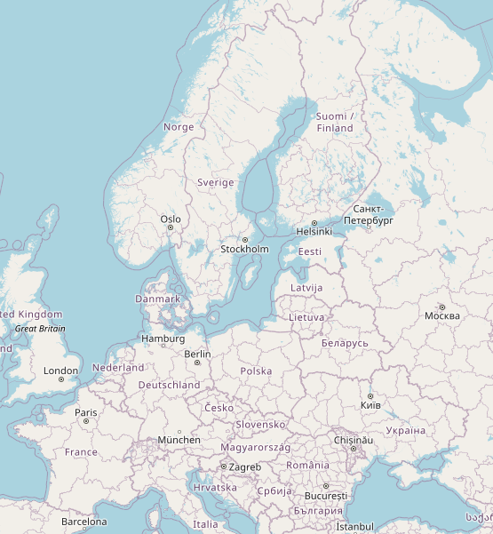
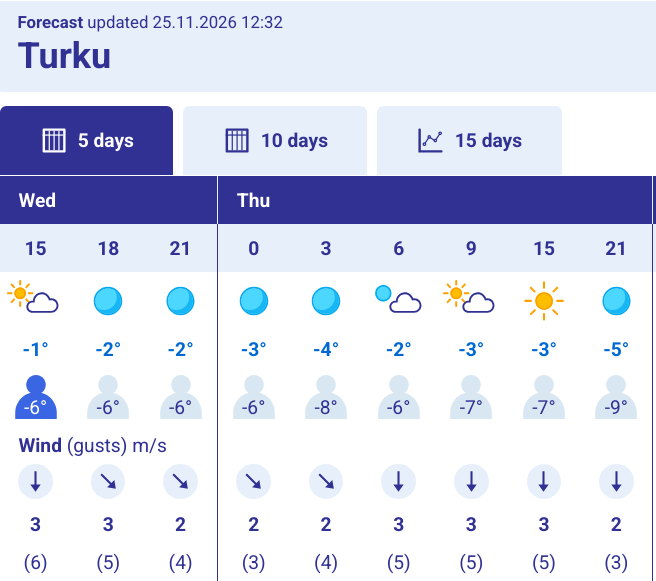

<div class="cover-grid">
  <div>
    <p class="eyebrow">Bioconductor Africa Seminar Series</p>
    <h1>An introduction<br>to Quarto</h1>
    <div class="meta">
      <span>Artur Sannikov</span>
      <span>University of Turku, Finland</span>
      <span>25 November 2026</span>
    </div>
  </div>
  <div class="doc-card">
    <div class="doc-bar">
      <span class="doc-dot"></span>
      <span class="doc-dot"></span>
      <span class="doc-dot"></span>
      <span class="doc-name">airway-report.qmd</span>
    </div>
    <div class="doc-line yaml">---</div>
    <div class="doc-line dim">title: "Airway RNA-seq report"</div>
    <div class="doc-line dim">format: html</div>
    <div class="doc-line yaml">---</div>
    <div class="doc-line code">```{r}</div>
    <div class="doc-line code">colSums(assay(airway, "counts"))</div>
    <div class="doc-line code">```</div>
  </div>
  <div class="cover-logos">
    <div class="cover-logo africa">
      
    </div>
    <div class="cover-logo bioc">
      
    </div>
  </div>
</div>

---
layout: default
class: about-slide
---

<div class="about-grid">
  <div class="about-photo">
    
  </div>
  <div>
    <p class="eyebrow">About me</p>
    <h1>Artur Sannikov</h1>
    <p class="about-role">Doctoral researcher</p>
    <p class="about-bio">
        Computational biologist in microbiome and food sciences.
    </p>
    <div class="cols-2">
      <div class="card">
        <div class="card-kicker">Focus</div>
        <div class="card-title">Impact of plant-based foods on human microbiome</div>
        <p>Processed food · Gut and saliva · Replicable science</p>
      </div>
      <div class="card">
        <div class="card-kicker">Toolbox</div>
        <div class="tool-tags">
          <span>R</span>
          <span>Bioconductor</span>
          <span>Quarto</span>
          <span>Git</span>
          <span>Linux</span>
          <span>Nix</span>
          <span>Bash</span>
          <span>Docker</span>
        </div>
      </div>
    </div>
    <p class="about-contact">
      <span>github.com/artur-sannikov</span>
      <span>asannikov.com</span>
      <span>hanhinevalab.utu.fi</span>
      <span>datascience.utu.fi</span>
    </p>
  </div>
</div>

---
layout: default
class: finland-slide
---

<div class="finland-head">
  <div>
    <p class="eyebrow">Where am I from?</p>
    <h1>About Finland</h1>
    <p class="finland-lead">
      A country in Northern Europe.
    </p>
  </div>
  <div class="finland-flag" aria-label="Flag of Finland"></div>
</div>

<div class="stat-row">
  <div class="stat"><strong>5.6M</strong><span>people</span></div>
  <div class="stat"><strong>188,000</strong><span>lakes</span></div>
  <div class="stat"><strong>~75%</strong><span>forest cover</span></div>
</div>

<div class="finland-body">
  <div class="card card-map">
    <div class="card-kicker">Location</div>
    
  </div>
  <div class="finland-facts">
    <div class="card card-weather">
      <div class="card-kicker">Weather</div>
      <div class="weather-body">
        
        <div>
          <div class="weather-temp">2.87 °C</div>
          <p>Average yearly temperature in Finland.</p>
        </div>
      </div>
    </div>
    <div class="card">
      <div class="card-kicker">Turku</div>
      <div class="card-title">Oldest city</div>
      <p>Former capital on the south-west coast; the University of Turku was founded in 1920.</p>
    </div>
  </div>
</div>

---
layout: statement
class: promise-slide
---

# Unified plain-text document

<p class="lead">for code, interpretation and reporting</p>

<div class="promise-chips">
  <span>HTML</span><span>PDF</span><span>Slides</span><span>Website</span>
</div>

---
layout: default
class: agenda-slide
---

# Agenda

<br>

| Topic                               | Details                                         |
|-------------------------------------|-------------------------------------------------|
| **Why Quarto?**                     | The problems it solves                          |
| **Anatomy of a .qmd**               | YAML, Markdown, code chunks, rendering          |
| **Live demo**                       | A small Bioconductor report, built from scratch |
| **Publication options**             | HTML, PDF, slides, websites                     |
| **Reproducibility & collaboration** | Versions, visibility, citations, projects       |
| **Recap**                           | A recommended starting workflow                 |
| **Questions**                       | Open discussion                                 |

---
layout: chapter
class: section-slide
---

<div class="section-cover">
  <div class="section-bg-no">01</div>
  <div class="section-inner">
    <div class="section-kicker">Part 1</div>
    <div class="section-rule"></div>
    <h1>Why Quarto?</h1>
    <p class="section-subtitle">The problems it solves</p>
  </div>
</div>

---
layout: default
---

# Data analysis and reporting are spread all over

<div class="cols-2">
  <div class="panel bad" v-click>
    <div class="panel-label">The usual data analysis workflow</div>
    <ul>
      <li>Scripts are in separate files, while reporting is in Word, figures are in some folder.</li>
      <li>It's a hassle to copy final numbers to the report file.</li>
      <li>Re-running is difficult: what was the script order? package versions?</li>
    </ul>
  </div>
  <div class="panel good" v-click>
    <div class="panel-label">Unified document</div>
    <ul>
      <li>The prose, code, figures, and tables are in one file.</li>
      <li>A number cannot change without the report changing with it.</li>
      <li>Re-running the report is simple.</li>
      <li>Sharing is simple.</li>
    </ul>
  </div>
</div>

---
layout: default
---

# Unified document → Many output options

<div class="one-source">
  <div class="source-card">
    <div class="ext">report.qmd</div>
    <h3>One source</h3>
    <p>prose + code + results + options</p>
  </div>
  <div class="flow-arrow">→</div>
  <div class="output-grid">
    <div class="output-chip">HTML<span>report</span></div>
    <div class="output-chip">PDF<span>print</span></div>
    <div class="output-chip">Slides<span>talk</span></div>
    <div class="output-chip">Website<span>docs</span></div>
  </div>
</div>

<div v-click>
    <div class="callout">
    <strong>The Quarto file is a source of truth.</strong>
    </div>
</div>

---
layout: default
---

# Under the hood

<div class="pipeline">
  <div class="pipeline-step" v-click="1">
    <div class="step-kicker">Source</div>
    <strong>.qmd</strong>
    <small>YAML + prose + code</small>
  </div>
  <div class="pipeline-arrow" v-click="2">→</div>
  <div class="pipeline-step" v-click="2">
    <div class="step-kicker">Engine</div>
    <strong>knitr</strong>
    <small>executes R chunks</small>
  </div>
  <div class="pipeline-arrow" v-click="3">→</div>
  <div class="pipeline-step" v-click="3">
    <div class="step-kicker">Converter</div>
    <strong>Pandoc</strong>
    <small>Markdown → target format</small>
  </div>
  <div class="pipeline-arrow" v-click="4">→</div>
  <div class="pipeline-step" v-click="4">
    <div class="step-kicker">Output</div>
    <strong>HTML · PDF</strong>
    <small>one format or several</small>
  </div>
</div>

<div class="cols-2" style="margin-top: 1rem">
  <div class="card" v-click="5">
    <div class="card-kicker">knitr</div>
    <p>Runs the code, creates figures and tables, and inserts the results into the Markdown.</p>
  </div>
  <div class="card" v-click="6">
    <div class="card-kicker">Pandoc</div>
    <p>Generates the final report in the target format.</p>
  </div>
</div>

<div class="callout" v-click="7">
<strong>You don't need to learn Pandoc to use Quarto.</strong>
</div>

---
layout: default
---

# Quarto for Bioconductor users

<div class="cols-3">
  <div class="card" v-click="1">
    <div class="card-kicker">Literate programming</div>
    <div class="card-title">Code and prose are combined</div>
    <p>Write the code, interpret and discuss the results in one place</p>
  </div>
  <div class="card" v-click="2">
    <div class="card-kicker">The prose</div>
    <div class="card-title">The report is a lab notebook</div>
    <p>The report can be later converted into a paper</p>
  </div>
  <div class="card" v-click="3">
    <div class="card-kicker">Sharing</div>
    <div class="card-title">Collaborators get a data analysis document and data</div>
    <p>Easy to version-control, share, and collaborate</p>
  </div>
</div>

<div class="callout" v-click="4">
<strong>If your collaborators agree, you can write the whole paper with Quarto.</strong>
</div>

---
layout: chapter
class: section-slide
---

<div class="section-cover">
  <div class="section-bg-no">02</div>
  <div class="section-inner">
    <div class="section-kicker">Part 2</div>
    <div class="section-rule"></div>
    <h1>Anatomy of a .qmd file</h1>
    <p class="section-subtitle">Three parts</p>
  </div>
</div>

---
layout: default
---

# Three parts

<div class="cols-3">
  <div class="card" v-click="1">
    <div class="card-kicker">01 · YAML</div>
    <div class="card-title">Metadata</div>
    <p>Title, author, date, output format, and global options.</p>
    <code>format: html</code>
  </div>
  <div class="card" v-click="2">
    <div class="card-kicker">02 · Markdown</div>
    <div class="card-title">Prose</div>
    <p>Headings, paragraphs, lists, links, captions, and cross-references.</p>
  </div>
  <div class="card" v-click="3">
    <div class="card-kicker">03 · Code</div>
    <div class="card-title">Analysis</div>
    <p>R chunks that run at render time and insert their results into the document.</p>
    <code>#| echo: false</code>
  </div>
</div>

<div class="callout" v-click="4">
<strong>A .qmd is rendered top to bottom in a clean environment.</strong>
</div>

---
layout: two-cols-header
class: code-medium
---

# The YAML header

<p class="muted">Metadata at the top of the file.</p>

::left::

```yaml
---
title: "Airway RNA-seq report"
author: "Artur Sannikov"
date: "2026-11-25"
format:
  html:
    code-fold: true
---
```

::right::

<div class="step-list">
  <div class="step">
    <div class="step-num">1</div>
    <div class="step-body"><strong>Starts and ends with <code>---</code>.</strong> Everything in-between is metadata.</div>
  </div>
  <div class="step">
    <div class="step-num">2</div>
    <div class="step-body"><strong><code>format:</code> choose the output.</strong> Can be html, pdf, etc.</div>
  </div>
  <div class="step">
    <div class="step-num">3</div>
    <div class="step-body"><strong>Indentation is important in YAML.</strong></div>
  </div>
  <div class="step">
    <div class="step-num">4</div>
    <div class="step-body"><strong>I suggest starting small.</strong></div>
  </div>
</div>

::bottom::

<div class="callout" style="margin-top: 0.4rem">
<strong>Get started with just <code>title:</code> and <code>format: html</code>.</strong>
</div>

---
layout: two-cols-header
class: code-medium
---

# Markdown is the prose

::left::

```markdown
# Samples

Eight airway samples, four cell lines,
treated or untreated with dexamethasone.

- **Total counts** vary by sample
- The table @tbl-metadata shows the metadata
- See @fig-total-counts
```

::right::

<div class="step-list">
  <div class="step">
    <div class="step-num">1</div>
    <div class="step-body"><strong>Use headings for organization.</strong></div>
  </div>
  <div class="step">
    <div class="step-num">2</div>
    <div class="step-body"><strong>Blank lines separate paragraphs.</strong></div>
  </div>
  <div class="step">
    <div class="step-num">3</div>
    <div class="step-body"><strong>Cross-reference tables and figures by label.</strong></div>
  </div>
</div>

---
layout: default
class: code-small
---

# Code chunks are the analysis

<p class="muted">A chunk is a fenced block with an engine in braces.</p>

````r
```{r}
#| label: fig-total-counts
#| fig-cap: "Total counts per sample."
#| echo: false

counts <- colSums(assay(airway, "counts"))
df <- data.frame(sample = names(counts), total = counts)

ggplot(df, aes(total, reorder(sample, total))) +
  geom_col(fill = "#2f6f9f") +
  labs(x = "Total counts", y = NULL)
```
````

<div class="callout">
<strong><code>#|</code> options are YAML inside the chunk.</strong> <code>label</code> and <code>fig-cap</code> create a numbered, cross-referenceable figure. <code>echo: false</code> runs the code but hides it.
</div>

---
layout: default
---

# Inline code and cross-references

<div class="cols-2">
  <div class="card">
    <div class="card-kicker">Inline result</div>
    <div class="card-title">Numbers that update</div>
    <p>Write the result in the prose:</p>
    <p>The dataset has <code>`r nrow(airway)`</code> rows.</p>
    <p class="small muted" style="margin-top: 0.6rem">The number is computed when the document renders.</p>
  </div>
  <div class="card">
    <div class="card-kicker">Cross-reference</div>
    <div class="card-title">Let Quarto number it</div>
    <p>Label the figure, then refer to the label:</p>
    <code>#| label: fig-total-counts</code>
    <p style="margin-top: 0.55rem">In the prose: see <code>@fig-total-counts</code>.</p>
    <p class="small muted" style="margin-top: 0.6rem">Use <code>@tbl-</code> for tables. Numbering is automatic.</p>
  </div>
</div>

<div class="callout">
<strong>Do not hard-code "Figure 1".</strong> Labels are kept after reordering, splitting, and re-rendering.
</div>

---
layout: two-cols-header
---

# Render, preview, repeat

::left::

<div class="card">
  <div class="card-kicker">In RStudio / Positron</div>
  <div class="card-title">Click <strong>Render</strong></div>
  <p>The button runs the whole document and opens the output. Use <strong>Preview</strong> for a live loop while you edit.</p>
  <p class="small muted">If the render fails, the error points to a chunk label or a line number.</p>
</div>

::right::

<div class="card">
  <div class="card-kicker">From a terminal</div>
  <div class="card-title">Two commands</div>
  <code>quarto render report.qmd</code>
  <code>quarto preview report.qmd</code>
  <p class="small muted" style="margin-top: 0.6rem">The first builds the output; the second serves a live preview.</p>
</div>

::bottom::

<div class="callout" style="margin-top: 0.4rem">
<strong>Render often.</strong>
</div>

---
layout: chapter
class: section-slide
---

<div class="section-cover">
  <div class="section-bg-no">03</div>
  <div class="section-inner">
    <div class="section-kicker">Part 3 · Live demo</div>
    <div class="section-rule"></div>
    <h1>Let's build a report and break it, and fix it</h1>
    <p class="section-subtitle">Airway RNA-seq</p>
  </div>
</div>

---
layout: default
---

# The demo: a small airway report

<div class="cols-2">
  <div>
    <div class="kicker">The data</div>
    <p><strong><code>airway</code></strong> is a Bioconductor RNA-seq dataset with eight samples: four airway smooth muscle cell lines, treated or untreated with dexamethasone.</p>
    <p>The counts and the sample metadata live in a <code>SummarizedExperiment</code>.</p>
    <div class="stat-row">
      <div class="stat"><strong>8</strong><span>samples</span></div>
      <div class="stat"><strong>4</strong><span>cell lines</span></div>
      <div class="stat"><strong>2</strong><span>conditions</span></div>
    </div>
  </div>
  <div>
    <div class="kicker">What we'll build</div>
    <div class="step-list">
      <div class="step" v-click="1"><div class="step-num">1</div><div class="step-body">Create a document with a title and HTML output</div></div>
      <div class="step" v-click="2"><div class="step-num">2</div><div class="step-body">Load the data</div></div>
      <div class="step" v-click="3"><div class="step-num">3</div><div class="step-body">Calculate and plot total counts per sample</div></div>
      <div class="step" v-click="4"><div class="step-num">4</div><div class="step-body">Add prose, a figure caption, and navigation</div></div>
      <div class="step" v-click="5"><div class="step-num">5</div><div class="step-body">Show the metadata table</div></div>
      <div class="step" v-click="6"><div class="step-num">6</div><div class="step-body">Render the HTML report</div></div>
      <div class="step" v-click="7"><div class="step-num">7</div><div class="step-body">Break syntax and re-render</div></div>
    </div>
  </div>
</div>

---
layout: two-cols-header
class: code-medium
---

# Step 1 · Create the document

<p class="muted">Save it as <code>airway-report.qmd</code>, then render immediately.</p>

::left::

```yaml
---
title: "Airway RNA-seq report"
author: "Your Name"
format: html
---
```

::right::

<div class="step-list">
  <div class="step">
    <div class="step-num">1</div>
    <div class="step-body"><strong>File → New File → Quarto Document.</strong> Give it a title and choose HTML.</div>
  </div>
  <div class="step">
    <div class="step-num">2</div>
    <div class="step-body"><strong>Render the skeleton.</strong> A blank page that renders is a working baseline.</div>
  </div>
  <div class="step">
    <div class="step-num">3</div>
    <div class="step-body"><strong>Add one heading and render again.</strong>.</div>
  </div>
</div>

::bottom::

<div class="callout" style="margin-top: 0.4rem">
<strong>One option is enough for now:</strong> <code>format: html</code>.
</div>

---
layout: default
class: code-medium
---

# Step 2 · Add intro and load libraries

```
# Samples

Eight airway samples from four airway smooth muscle cell lines, treated or
untreated with dexamethasone [@himes2014]. The counts and sample metadata are
stored together in a `SummarizedExperiment`.
```

```r
#| label: import-libraries
### #| message: false
library(airway)
library(SummarizedExperiment)
library(ggplot2)
```

<div class="callout">
What's the message?
</div>

---
layout: default
class: code-medium
---

# Step 3 · Load data

```r
#| label: load-data
data(airway)
```

```
Try to break the rendering process. Why do we load data here? What if we load it
after "Number of rows"?

## Number of rows

The dataset has `r nrow(airway)` rows.
```

---
layout: default
class: code-medium
---


# Step 4 · Compute and plot total counts

```
## Total counts

The figure below is generated from the counts assay every time the report is
rendered.
```

```r
#| label: fig-total-counts
#| fig-cap: "Total counts per sample."

counts <- colSums(assay(airway, "counts"))
df <- data.frame(sample = names(counts), total = counts)

ggplot(df, aes(total, reorder(sample, total))) +
  geom_col(fill = "#2f6f9f") +
  labs(x = "Total counts", y = NULL)
```

```
Total counts are shown in @fig-total-counts.
```

```
Let's break the figure?
```

<div class="callout">
<strong>The label makes figure cross-referencable.</strong>
</div>

<!--
Side note: you can use inline code inside figure captions
(!expr paste("Mean:", mean_value))
-->

---
layout: default
---

# Step 5 · Add navigation

```yaml
format:
  html:
    toc: true
```

The table of contents is built from the heading hierarchy.

---
layout: default
class: code-medium
---

# Step 6 · Create a metadata table

```r
#| label: tbl-metadata
#| tbl-cap: "Airway sample metadata."

meta <- as.data.frame(colData(airway))
meta[, c("SampleName", "cell", "dex", "albut")]
```

<div class="callout">
<strong>It looks bad!</strong>
</div>

---
layout: default
class: code-medium
---

# Step 7 · Let's improve the metadata table

```
See @tbl-metadata-knitr, formatted with `knitr`.
```

```r
#| label: tbl-metadata-knitr
#| tbl-cap: "The same metadata, formatted with `knitr`."
meta[, c("SampleName", "cell", "dex", "albut")] |>
  knitr::kable(
    col.names = c("Sample", "Cell line", "Dexamethasone", "Albuterol"),
    row.names = FALSE,
    align = "lccc"
  )
```

<div class="callout">
<strong>It looks better!</strong>
</div>


---
layout: default
class: code-medium
---

# Step 8 · Metadata table with highlights

```r
#| label: tbl-metadata-highlighted
#| tbl-cap: "The same metadata, with the two N61311 samples highlighted."

highlight_rows <- which(meta$cell == "N61311")

meta[, c("SampleName", "cell", "dex", "albut")] |>
  knitr::kable(
    col.names = c("Sample", "Cell line", "Dexamethasone", "Albuterol"),
    row.names = FALSE
  ) |>
  kableExtra::kable_styling(full_width = TRUE) |>
  kableExtra::row_spec(highlight_rows, background = "#fff3cd")
```

<div class="callout">
<strong>It looks highlighted!</strong>
</div>

---
layout: chapter
class: section-slide
---

<div class="section-cover">
  <div class="section-bg-no">04</div>
  <div class="section-inner">
    <div class="section-kicker">Part 4</div>
    <div class="section-rule"></div>
    <h1>Publication options</h1>
    <p class="section-subtitle">HTML, Word, PDF, slides, websites, dashboards</p>
  </div>
</div>

---
layout: default
---

# Pandoc and Quarto support many output options

| Format    | YAML                     | Best for                              |
| --------- | ------------------------ | ------------------------------------- |
| HTML      | `format: html`           | lab reports, notebooks, web pages     |
| Word      | `format: docx`           | co-authors, journals, tracked changes |
| PDF       | `format: pdf`            | print, preprints, archival copies     |
| Slides    | `format: revealjs`       | talks, teaching, journal club         |
| Website   | project + `format: html` | lab site, documentation, course       |
| Dashboard | `format: dashboard`      | live summaries, monitoring            |

<div class="callout">
<strong>PDF needs LaTeX (TinyTeX).</strong>
</div>

<p class="small muted" style="margin-top: 0.5rem">Live examples: <a href="https://quarto.org/docs/gallery/">quarto.org/docs/gallery</a></p>

---
layout: default
class: code-medium
---

# You can set up several outputs

```yaml
format:
  html:
    toc: true
  pdf: default
```

```bash
quarto render report.qmd            # build both
quarto render report.qmd --to pdf  # build just one
```

<div class="callout">
<strong>Output-specific options live under each format.</strong>
</div>

---
layout: chapter
class: section-slide
---

<div class="section-cover">
  <div class="section-bg-no">05</div>
  <div class="section-inner">
    <div class="section-kicker">Part 5</div>
    <div class="section-rule"></div>
    <h1>Reproducibility & collaboration</h1>
    <p class="section-subtitle">versions, visibility, citations, project organisation</p>
  </div>
</div>

---
layout: default
---

# Package versions are part of the report


```r
renv::init()
renv::snapshot()
renv::restore()
```

<div class="cols-2" style="margin-top: 0.8rem">
  <div class="card">
    <div class="card-kicker">What to commit</div>
    <div class="card-title"><code>renv.lock</code></div>
    <p>The lockfile records the exact package versions. Commit it with the report.</p>
  </div>
  <div class="card">
    <div class="card-kicker">What to check</div>
    <div class="card-title">The runtime</div>
    <p><code>sessionInfo()</code> documents R and package versions. <code>quarto check</code> checks the toolchain.</p>
  </div>
</div>

<div class="callout">
<strong>Let's try it out?</strong>
</div>

<!--
Our report is not just the prose and the code, but also all the packages and
the environment that we need to reproduce the analysis.
-->

---
layout: default
---

# Code visibility and caching

| Option            | What it does                      | Use when                            |
| ----------------- | --------------------------------- | ----------------------------------- |
| `echo: false`     | runs code, hides the source       | the audience only needs the result  |
| `code-fold: true` | hides code behind a toggle        | readers may want to inspect it      |
| `eval: false`     | shows code, does not run it       | a placeholder or a teaching example |
| `cache: true`     | reuses chunk output               | the computation is expensive        |

---
layout: two-cols-header
class: code-medium
---

# Citations and scholarly metadata

<p class="muted"></p>

::left::

```yaml
bibliography: references.bib
csl: nature.csl
```

<p class="small muted" style="margin-top: 0.7rem">Keep the <code>.bib</code> file and the CSL style next to the report, in version control.</p>
<p class="small muted" style="margin-top: 0.7rem">More styles can be found <a href="https://github.com/citation-style-language/styles" target="_blank" rel="noopener">here</a>.</p>

::right::

<div class="step-list">
  <div class="step">
    <div class="step-num">1</div>
    <div class="step-body">Cite with a key: <code>[@himes2014]</code>. The entry comes from <code>references.bib</code>.</div>
  </div>
  <div class="step">
    <div class="step-num">2</div>
    <div class="step-body">Change the CSL file to change the journal style, not the bibliography.</div>
  </div>
</div>

---
layout: two-cols-header
class: code-medium
---

# How to organise the project

<p class="muted">A report is a small project with a source, data, and an environment.</p>

::left::

```text
airway-report/
├── airway-report.qmd
├── references.bib
├── _quarto.yml
├── R/
│   └── helpers.R
├── data/
└── renv.lock
```

::right::

<div class="step-list">
  <div class="step"><div class="step-num">1</div><div class="step-body"><strong>One project root.</strong> Keep the report, data, and helper code together.</div></div>
  <div class="step"><div class="step-num">2</div><div class="step-body"><strong>Relative paths.</strong> Avoid absolute paths that only work on your machine.</div></div>
  <div class="step"><div class="step-num">3</div><div class="step-body"><strong><code>_quarto.yml</code></strong> for project-wide options when a single file is no longer enough.</div></div>
  <div class="step"><div class="step-num">4</div><div class="step-body"><strong>Outputs out of git?</strong> Often yes, but sometimes not.</div></div>
</div>

---
layout: default
class: code-medium
---

# Example `_quarto.yml`

```yaml
project:
  execute-dir: project
  output-dir: _output
  render:
    - dev/*.qmd
    # LimROTS is run a separate repo
    - "!dev/limrots_daa.qmd"

format:
  html:
    toc: true
  pdf:
    toc: true
    pdf-engine: lualatex
    include-in-header:
      text: |
        \usepackage{colortbl}
```

---
layout: default
---

# Collaboration checklist

<div class="cols-2">
  <div class="card">
    <div class="card-kicker">Version control</div>
    <div class="card-title">What goes into git</div>
    <ul>
      <li>The <code>.qmd</code> source and <code>references.bib</code></li>
      <li><code>renv.lock</code> and <code>_quarto.yml</code></li>
      <li>Data provenance: a download script or a DOI</li>
      <li>A README with the render command</li>
    </ul>
  </div>
  <div class="card">
    <div class="card-kicker">Review and sharing</div>
    <div class="card-title">What to check before sharing</div>
    <ul>
      <li>Review the <code>.qmd</code></li>
      <li>Run one clean render from a fresh session</li>
      <li>Check the figure captions and cross-references</li>
      <li>Confirm the intended format opens for the reader</li>
    </ul>
  </div>
</div>

---
layout: chapter
class: section-slide
---

<div class="section-cover">
  <div class="section-bg-no">06</div>
  <div class="section-inner">
    <div class="section-kicker">Part 6</div>
    <div class="section-rule"></div>
    <h1>Recap</h1>
  </div>
</div>

---
layout: default
---

# A recommended starting workflow

<div class="workflow">
  <div class="workflow-step">
    <div class="workflow-num">1</div>
    <div class="workflow-body"><strong>Start a project.</strong> <span>Install packages, snapshot with renv</span></div>
  </div>
  <div class="workflow-step">
    <div class="workflow-num">2</div>
    <div class="workflow-body"><strong>Create a minimal <code>.qmd</code>.</strong> <span>Title, author, <code>format: html</code>.</span></div>
  </div>
  <div class="workflow-step">
    <div class="workflow-num">3</div>
    <div class="workflow-body"><strong>Add one chunk at a time.</strong> <span>Ideally try to render as much as possible, but in my experience it does not always work well.</span></div>
  </div>
  <div class="workflow-step">
    <div class="workflow-num">4</div>
    <div class="workflow-body"><strong>Add labels and captions.</strong> <span>Cross-reference figures and tables.</span></div>
  </div>
  <div class="workflow-step">
    <div class="workflow-num">5</div>
    <div class="workflow-body"><strong>Commit the source</strong> <span>Commit often.</span></div>
  </div>
</div>

---
layout: default
---

# Resources

<div class="cols-2">
  <div class="card">
    <div class="card-kicker">Quarto</div>
    <ul>
      <li><a href="https://quarto.org/docs/get-started/">Get started</a></li>
      <li><a href="https://quarto.org/docs/gallery/">Gallery of examples</a></li>
      <li><a href="https://ivelasq.quarto.pub/building-a-blog-with-quarto/learn-more/migrate-blog/">R Markdown → Quarto</a></li>
      <li><a href="https://quarto.org/docs/presentations/revealjs/">Reveal.js slides</a></li>
      <li><a href="https://quarto.org/docs/websites/">Websites</a></li>
      <li><a href="https://quarto.org/docs/reference/">Reference</a></li>
    </ul>
  </div>
  <div class="card">
    <div class="card-kicker">R / Bioconductor</div>
    <ul>
      <li><a href="https://rstudio.github.io/renv/">renv</a> for project environments</li>
      <li><a href="https://docs.ropensci.org/rix/">rix</a> for project environments and complete reproducibility</li>
      <li><a href="https://bioconductor.org/packages/airway/">airway package</a></li>
      <li><a href="https://bioconductor.org/help/docker/">Bioconductor Docker images</a></li>
    </ul>
  </div>
</div>

---
layout: chapter
---

<div class="closing-slide">
  <div class="closing-inner">
    <div class="closing-kicker">open discussion</div>
    <h1>Questions?</h1>
  </div>
</div>

